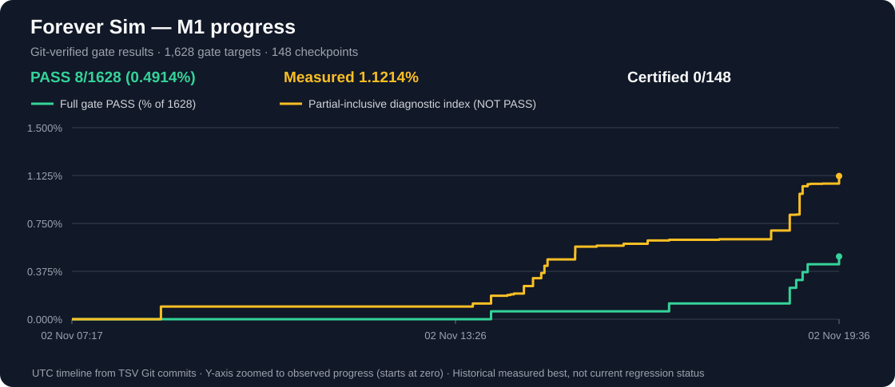

> **Migration status (2026-11-01): COMPLETE.** [Public P0 issue #25](https://github.com/dosibjrn/forever-sim/issues/25) records the pinned audited source publication: 1,877 permitted paths published from 1,914 tracked private paths, with 37 intentionally protected. [Independent public checkout and LFS hydration](https://github.com/dosibjrn/forever-sim/actions/runs/41255246045) succeeded with 13/13 snapshot tests; 11 SQLite and three large JSON LFS payloads were hydrated. Legacy private auto-trigger workflows remain excluded deliberately. `dosibjrn/mage-level-sim` is historical read-only source. **This migration result is not itself a checkpoint PASS; use the current nine-gate M1 ledger and chart below.**

# WoW Forever — simulator and optimizer

**Engine ownership and migration:** The approved end state is **one game-rules authority: the exact-SHA-pinned [MythicSim Rust fork](https://github.com/dosibjrn/mythicsim-forever-engine)**. Rust owns Warcraft source facts, build legality, combat mechanics and game-world execution. Forever defines scenarios, proposes and searches candidates, scores native results and verifies the unchanged gate contracts. Python GameIR, source catalogues, Go/gsim bridges and Python world code in the **current** tree are transitional live dependencies, not additional permanent sources of game truth; migrate their real consumers and verify native replacement before deleting them. See [#357](https://github.com/dosibjrn/forever-sim/issues/357), [#359](https://github.com/dosibjrn/forever-sim/issues/359) and the [target architecture](docs/REPOSITORY_STRUCTURE.md).

## M1 — nine active gates, measured history and checkpoint certification

**Current graph:** the historical TSV is recalculated using **nine active P3–P7.5 gates per checkpoint** (1,332 active gate targets across 148 checkpoints). The green line is genuine gate PASSes, yellow adds measured PARTIAL fractions. **Druid L60 Balance already has 9/9 PASSes and counts as 1/148.** No cross-gate metadata certificate is required.

The [M1 ledger](docs/planning/M1_PASSES.tsv) is the only measurement source. Its Git history supplies the timestamps. Each [Merge-launched on-demand gate run](.github/workflows/m1-on-demand-record.yml) that improves the recorded results updates the ledger **and this chart together** on main. No chart-only scheduling, synthetic progress, or independent status records.

## Upstream inspiration and acknowledgments

This is an independent Forever simulation and optimization research project. The combat execution and reference-parity work builds on **[MythicSim](https://www.mythicsim.com/wow-forever)** and its open-source [Rust Forever engine](https://github.com/sage3648/mythicsim-forever-engine) and [Go reference fork](https://github.com/sage3648/mythicsim-forever-engine-go). Thanks to the MythicSim and WoWSims contributors for the engines, mechanics research, reference results, and open tooling.

**Credit and scope:** this repository is not the official MythicSim project and is not affiliated with its maintainers. Engine references and pinned versions must remain traceable; upstream licenses and notices govern any adapted code.

**The ledger is authoritative.** The SVG is derived from versioned TSV snapshots: only genuine accepted gate PASSes certify checkpoints. Green CI without gate execution is not acceptance, and a separate checkpoint metadata proof is not required.

## Work queue and the 148-checkpoint matrix

**At the current ledger snapshot: 1/148 accepted checkpoints — Druid L60 Balance has 9/9 genuine active gate PASSes.** Run `python tools/m1_progress.py` for live counts. Four levels **20, 30, 40 and 60** × (9 unrestricted classes + 4 Druid profiles + 24 other profiles) = **37 per level**. Level 50 is **not** in the approved 148-checkpoint scope.

| Level | Unrestricted | Druid spec profiles | Other class spec profiles | Total |
| --- | ---: | ---: | ---: | ---: |
| 20 | 9 | 4 | 24 | 37 |
| 30 | 9 | 4 | 24 | 37 |
| 40 | 9 | 4 | 24 | 37 |
| 60 | 9 | 4 | 24 | 37 |
| **Total** | **36** | **16** | **96** | **148** |

**Current approved execution policy:** MythicSim **Rust preferred, Go equally valid** under PROCESS, with one selected pinned engine per compatible gate chain and live gsim-2D integration wherever required. The Rust-only target architecture does not silently remove an approved Go path or existing causal world requirement. Build PASS is not gameplay PASS.

**Current work:** follow [WORK_PRIORITY](docs/planning/WORK_PRIORITY.md) and [PROCESS v2.22](PROCESS.md), not obsolete P7 2D-only tasks or checkpoint-level provenance audits. Druid L60 Balance already counts as 1/148. Fix missing active gate behavior elsewhere; correct or invalidate only genuinely defective gate results.

**Balance Druid L60 P7.3 historical receipt:** [WF663](docs/evidence/druid-l60-balance/p7.3/WF663_ACCEPTANCE.md) is historical diagnostic evidence. Current P7.3 is a native-paid talent-axis capability under [the approved P7 contract](docs/gates/P7.md), not a separate 2D causality gate.

**P7 under the approved reduced contract:** P7.1 has one real 1,000-stochastic native reference and a 99% floor; P7.2–P7.4 each demonstrate a genuinely paid legal changed rotation/talent/gear axis, with no independent 300-second or stochastic holdout requirement; P7.5 keeps the independent 300-second joint search and 1,000-stochastic mean against the 93% accepted-compatible reference/prior. The stationary DPS benchmark is native-only, while P4–P6 retain real spatial native↔world 100-mob execution. [P7](docs/gates/P7.md) is authoritative.

**Active gate scope:** P3 native-backed gear smoke; P4/P5 one real cold 300s search with 30s snapshot and complete 100-mob winners; P6 measured 1% saturation (T30 <= 1.01 × T300); P7.1 pinned native reference; P7.2–P7.4 paid legal axis changes; P7.5 independent cold 300s joint search and frozen stochastic holdout. The live [priority queue](docs/planning/WORK_PRIORITY.md) chooses work, not a hard-coded class order.

**Implementation and acceptance:** develop and merge focused, regression-tested production improvements incrementally. Run expensive active P3–P7.5 acceptance only when ready; P1/P2 are retired and must not be reintroduced. Merge alone records genuine PASS timestamps in the canonical M1 ledger. The authoritative requirements are [PROCESS.md](PROCESS.md), [gate predicates](docs/gates/README.md) and [OVERALL_PLAN.md](OVERALL_PLAN.md).

## Command launchers

Keep the stable root entry points `./run.sh` and `./run.ps1`. Less common
validation, release/listener smoke, service-control and source-capture wrappers
are in [`scripts/commands/`](scripts/commands/README.md) (issue #14 phase 2A).
For example: `bash scripts/commands/run-validation-fast.sh`.
The `run-fast`, `run-both`, `run-v2`, `run-forever` and `run-mc` variants
are in [`scripts/commands/`](scripts/commands/README.md) (issue #14 phase 2B).
For example: `bash scripts/commands/run-fast.sh --optimize-only` or
`pwsh -File scripts/commands/run-forever.ps1 -NoListener`.
The root `run.sh` and `run.ps1` remain unchanged stable entry points.

## Find your way around

| Current path | Current purpose / migration status |
| --- | --- |
| [`src/`](src/) | Scenario/search/scoring/service code plus **transitional** Python GameIR, ruleset and world-runtime callers; no permanent second game-mechanics authority |
| [`tests/`](tests/README.md) | Unit, regression, integration and acceptance tests (currently mostly flat) |
| [`tools/`](tools/) | Python gate/capture/ingest/audit entry points |
| [`data/`](data/) | Retained source snapshots, catalogues and staged databases needed by current callers/evidence during native migration |
| [`docs/`](docs/INDEX.md) | Canonical documentation map, accepted reference evidence and source notes |
| [`docs/evidence/`](docs/evidence/README.md) | Curated accepted gate decisions, reproducible requests/results and build proof |
| [`evidence/`](evidence/README.md) | Historical WF experiments; **not** the current PASS scoreboard |
| `config/gates/`, `gate_sources/`, `gate_evidence/` | Static gate applicability policy, source inputs and machine evidence |

**[Large assets and Git LFS migration](docs/LARGE_ASSETS_LFS.md)** — binary catalogues, large historical JSON and source archives; public LFS payloads were hydrated in an independent checkout; do not mistake pointer files for hydrated bytes.

**[Clean-owned ideal repository architecture and convergence rules](docs/REPOSITORY_STRUCTURE.md).** The numerous shell/PowerShell launchers are a completed [historical private-repo launcher cleanup](https://github.com/dosibjrn/mage-level-sim/issues/14); `run.sh` and `run.ps1` remain stable root entry points.
